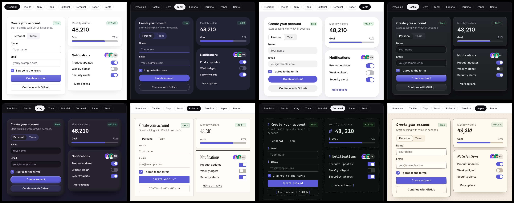

<div align="center">


# VinUI: free, open source UI component library

**63 accessible UI components in 8 styles, for HTML, React, Vue and Svelte.**<br>
Copy them into your project with one command and own the code. MIT licensed.

[](https://www.npmjs.com/package/@vinish/ui)
[](LICENSE)
[](#accessible-by-default)
[](https://github.com/devvinish/vin-ui/stargazers)

[**Website**](https://vinish.dev/ui) · [Components](https://vinish.dev/ui/components) · [Styles](https://vinish.dev/ui/styles) · [Blocks](https://vinish.dev/ui/blocks) · [Theme builder](https://vinish.dev/ui/create) · [Docs](https://vinish.dev/ui/docs/installation)

<br>



</div>

## Why VinUI

- 🎨 **8 styles, one set of components.** Precision, Tonal, Bento, Tactile, Clay, Editorial, Terminal and Paper. Switch the whole look by changing one attribute; your markup never changes.
- 🧩 **63 components plus ready-made blocks.** Forms, data tables, charts, dialogs, menus, a date picker, a command palette and AI chat parts.
- ⚛️ **HTML, React, Vue and Svelte.** The same components and the same markup in all four. Plain HTML needs just a stylesheet.
- 📦 **You own the code.** The CLI copies components into your project, so you can change anything. `npx @vinish/ui diff` shows how your copy differs from the latest version.
- 🌗 **Light and dark mode, any accent colour.** Text colours are worked out to stay readable on whatever accent you pick.
- ♿ **Accessible by default.** Keyboard support, visible focus rings, and automated WCAG 2.2 AA checks in every style.
- 🤖 **Works with AI coding tools.** Claude Code, Cursor, Codex and Copilot can add components with the same CLI, and the docs ship as `llms.txt`.

## Quick start

```bash
npx @vinish/ui init
npx @vinish/ui add button card dialog
```

The CLI detects React, Vue, Svelte or plain HTML from your `package.json`, writes the component files into your project and records them in `vin.json`.

**Plain HTML, no build step:** link the stylesheet, set a style on `<html>`, and copy any component's markup from the [component pages](https://vinish.dev/ui/components).

```html
<html data-vin-style="precision" style="--vin-accent: #5b5bd6">
  <head>
    <link rel="stylesheet" href="https://vinish.dev/ui/v1/precision.css">
    <!-- Only for interactive components (Select, Tabs, Dropdown Menu…) -->
    <script src="https://vinish.dev/ui/v1/vinui.js" defer></script>
  </head>
  <body>
    <button class="vin-btn">Get started</button>
  </body>
</html>
```

Each style's font link is on the [Styles page](https://vinish.dev/ui/styles). `vinui.js` is one small script with no dependencies; dialogs use the browser's own `<dialog>` and work without it.

## Styles

Every style is a set of design tokens (colours, radii, shadows, fonts) plus a few style-specific CSS rules. Pick one, set any accent colour, and every component follows.

| Style | Look |
| --- | --- |
| **Precision** | Clean and neutral, thin borders, 6px corners |
| **Tonal** | Soft filled surfaces, no hard borders |
| **Bento** | Big rounded tiles and pill buttons |
| **Tactile** | Bevelled, physical buttons and switches |
| **Clay** | Puffy, raised and soft-shadowed |
| **Editorial** | Serif headings, magazine-like type |
| **Terminal** | Monospace, dashed frames, command-line feel |
| **Paper** | Hand-drawn borders and handwritten headings |

Try them all on the [Styles page](https://vinish.dev/ui/styles), or make and share your own theme with the [theme builder](https://vinish.dev/ui/create).

```html
<html data-vin-style="tactile" data-vin-mode="dark" data-vin-radius="lg" style="--vin-accent: #0d9488">
```

## Components

Every component works in all 8 styles, in light and dark mode, and in all four frameworks.

| Group | Components |
| --- | --- |
| **Actions** | Button, Button Group, Toggle, Toggle Group |
| **Forms** | Input, Input Group, Input OTP, Textarea, Checkbox, Radio Group, Switch, Native Select, Select, Combobox, Slider, Calendar, Date Picker |
| **Data display** | Badge, Card, Avatar, Kbd, Table, Data Table, Item, Empty, Typography, Code Block, Carousel, Chart |
| **Feedback** | Alert, Progress, Skeleton, Spinner, Toast |
| **Layout** | Separator, Aspect Ratio, Accordion, Collapsible, Tabs, Scroll Area, Resizable |
| **Navigation** | Breadcrumb, Pagination, Navigation Menu, Menubar, Sidebar |
| **Overlays** | Dialog, Alert Dialog, Sheet, Drawer, Popover, Hover Card, Tooltip, Dropdown Menu, Context Menu, Command |
| **AI chat** | Message, Bubble, Message Scroller, Attachment, Marker, Questionnaire, Trace |

See live examples in the [component gallery](https://vinish.dev/ui/components), and full page sections (login, dashboard, pricing and more) on the [Blocks page](https://vinish.dev/ui/blocks).

## Accessible by default

- Text meets WCAG AA contrast (4.5:1) in every style, in light and dark.
- Every interactive part works with the keyboard and shows a clear focus ring.
- Every component is checked with axe (WCAG 2.2 AA) and screenshot-tested in all 16 style and mode combinations: about 1,400 automated tests.

## For AI coding tools

- **CLI:** AI agents run `npx @vinish/ui add <name>` just like you do. Rules to paste into your project: [vinish.dev/ui/docs/ai](https://vinish.dev/ui/docs/ai)
- **llms.txt:** [`vinish.dev/ui/llms.txt`](https://vinish.dev/ui/llms.txt) and `llms-full.txt`
- **Registry (JSON):** `https://vinish.dev/ui/r/{html|react|vue|svelte}/{name}.json`

## How it works

- **One spec per component.** `spec/<name>.json` defines the props, anatomy and examples. The HTML snippets are checked against it, and the React, Vue and Svelte versions are tested to render the same markup.
- **Tokens, not hard-coded colours.** Component CSS only uses `var(--vin-*)` tokens, so it works in every style automatically.
- **The theme lives on one element**, usually `<html>`: style, mode, radius and accent colour.

## Contributing

Issues and pull requests are welcome. The one rule: a component ships only when it works in all 8 styles, in light and dark, in every framework. See [CONTRIBUTING.md](CONTRIBUTING.md) to get started, and [MAINTAINING.md](MAINTAINING.md) for how the repository and website are built and released.

If VinUI saves you time, a ⭐ on GitHub helps other people find it.

## License

[MIT](LICENSE) © [vinish.dev](https://vinish.dev)
